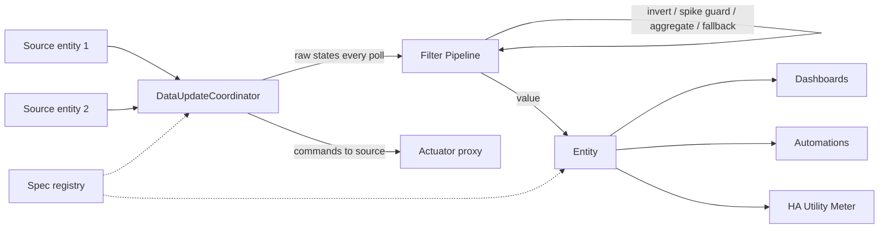

# AbstrHActor

The `abstractor` custom integration abstracts physical devices behind stable,
hardware-independent Home Assistant entities, so you can swap the concrete
hardware (Zendure, Shelly, Tasmota, …) without touching automations,
dashboards, or utility meters.

It provides three kinds of logical entity:

- **Sensors** — `power`, `energy`, `water`, and an integrating `riemann_energy`.
- **Binary sensors** — `door_contact`, `motion`, `smoke`.
- **Actuators** — `switch`, `light`, and `cover` (position), which *proxy* an
  underlying source entity: Abstractor reads the source's state and forwards
  commands to it, and never talks to hardware directly.

Everything is configured through the UI. A device-agnostic **management
sidebar panel** lists the configured entities, shows pipeline health, and — in
an admin-gated Edit mode — lets you create, edit, rename, and delete them.

## Features

- **Hardware abstraction** — automations, dashboards, and utility meters only
  ever see the abstract entity, never the physical device. Swapping hardware is
  a reconfiguration, not a rewrite.
- **Stable identity** — every entity is pinned to a unique ID at creation, so a
  later hardware swap keeps the same `entity_id` and recorder history
  (REQ-CORE-001/003).
- **Aggregation** — sum multiple source entities into one sensor (e.g. several
  sockets of a power strip), with `sum`, `max`, `min`, or `first_available`.
- **Spike filter** — a monotonic guard rejects counter drops below the last
  valid value, protecting long-term statistics.
- **Inversion** — multiply values by `-1` to model net flows (load minus
  feed-in).
- **Fallbacks** — fall back to `0`, to a secondary source, or to a conditional
  fallback source when the primary is unavailable.
- **Actuators as proxies** — `switch`/`light` forward on/off and `cover`
  forwards open/close/position to the configured source entity's service.
- **Riemann energy** — integrate a power source over time into accumulated
  energy (kWh), restored across restarts.
- **Device bundling** — cluster several abstract entities under one shared
  Home Assistant device via the reconfigure flow, or keep one device each.
- **Management sidebar panel** — read-only by default; an admin Edit mode
  exposes an in-panel form (device type, sources, identity, pipeline), rename,
  and delete-with-confirm, with live updates pushed over a websocket
  subscription.
- **Export / Import / Delete services** — versioned snapshot for backup and
  restore, plus a delete service.
- **Diagnostics** — native HA diagnostics for support and debugging.

## Architecture

A single **root config entry** (a HA singleton, `unique_id = "abstractor_root"`)
holds every abstract entity as a **config subentry**. One shared
`DataUpdateCoordinator` polls all subentries' sources every interval, and a
declarative **spec registry** (`specs.py`) is the single source of truth for
which types exist, which platform they belong to, and how they behave.



### Data flow

1. **`AbstractorDataUpdateCoordinator`** — one shared `DataUpdateCoordinator`
   polls every subentry's source entities per interval and caches the results.
2. **`AbstractorFilterPipeline`** — for numeric sensor types, processes the raw
   states: non-numeric/unavailable handling, optional inversion, monotonic
   spike guard, aggregation, and fallback logic. Power fails soft to `0`;
   energy and water fail closed to `unavailable`. Non-numeric types
   (binary sensors and actuators) use the raw source state directly.
3. **Entities** — a `CoordinatorEntity` exposes the result as a native HA
   entity with the correct `device_class`, `state_class`, and
   `unit_of_measurement`, grouped into a logical device via `device_info`.

### Supported types

The config flow offers exactly the types enabled in the spec registry.

| `device_type` | Platform | Unit | State class | Behaviour |
|---|---|---|---|---|
| `power` | `sensor` | `W` | `measurement` | fail soft to `0` |
| `energy` | `sensor` | `kWh` | `total_increasing` | fail closed to `unavailable` |
| `water` | `sensor` | `L` | `total_increasing` | fail closed to `unavailable` |
| `riemann_energy` | `sensor` | `kWh` | `total_increasing` | integrates the source power over time; restored across restarts |
| `door_contact` | `binary_sensor` | — | — | pass-through of the source state |
| `motion` | `binary_sensor` | — | — | pass-through of the source state |
| `smoke` | `binary_sensor` | — | — | pass-through of the source state |
| `switch_state` | `switch` | — | — | proxy: reads the source, forwards `turn_on`/`turn_off` |
| `light_state` | `light` | — | — | proxy: reads the source, forwards `turn_on`/`turn_off` (on/off only) |
| `cover_position` | `cover` | `%` | — | proxy: position + `open_cover`/`close_cover`/`set_cover_position` |

## Management panel

The integration registers a sidebar panel named **Abstractor** (at `/abstractor`).

- **Read-only base** — lists every abstract entity with its value and a health
  badge (`ok` / `warn` / `bad` / `idle`) derived from the pipeline metadata
  (spike rejections, fallbacks, unavailable samples, stale).
- **Live updates** — the panel subscribes to `abstractor/subentries/subscribe`,
  so values and health refresh automatically; a one-shot fetch is the fallback.
- **Edit mode** (administrators only) — reveals an in-panel form to create or
  edit an entity (device type, source entities, numeric pipeline), a **Rename**
  action (logical name / `object_id`, optionally renaming the `entity_id`), and
  **Delete**-with-confirm. Device-to-device *moves* remain in the native config
  flow, which owns the device-mapping transaction.
- **Migrate tab** — a read-only YAML scan preview (placeholder).

Write commands are authorized server-side solely by Home Assistant admin
privileges (`websocket_api`).

### Websocket API

| Command | Auth | Purpose |
|---|---|---|
| `abstractor/subentries` | admin | One-shot list of subentries with value + health |
| `abstractor/subentries/subscribe` | admin | Push subentry updates on every coordinator refresh |
| `abstractor/subentry/create` | admin | Create a subentry (config-flow helpers, incl. mapping safety) |
| `abstractor/subentry/update` | admin | Update a subentry |
| `abstractor/subentry/delete` | admin | Delete a subentry |
| `abstractor/options/update` | admin | Update the root entry's options |
| `abstractor/logical_rename` | admin | Set logical name / `object_id`, optionally rename the entity |
| `abstractor/yaml_scan` | admin | Read-only YAML migration preview |

## Quick start

### 1. Install

**Via HACS** (recommended): add this repository as a custom repository
(`https://github.com/Popoboxxo/AbstrHActor`, category *Integration*) and install
*Abstractor*. **Manual install:** copy `custom_components/abstractor/` into your
HA `config/custom_components/` directory and restart Home Assistant.

### 2. Add the integration (root entry)

Go to **Settings > Devices & services > Add Integration**, search for
**Abstractor**, and submit. This creates the (singleton) root entry that holds
all abstract entities.

### 3. Add an entity

On the Abstractor integration page, choose **Add Abstract sensor** (or use the
panel's Add action). The flow has two steps:

1. **Device type** — one of the supported types (`power`, `riemann_energy`,
   `door_contact`, `switch_state`, `cover_position`, …).
2. **Details** — the source entity/entities and, for numeric types, the pipeline
   options (aggregation, spike filter, inversion, fallbacks). Binary and
   actuator types never see the numeric-only fields.

A new entity appears immediately with a stable unique ID.

### 4. Swap hardware later

Reconfigure the subentry (Reconfigure on the integration page, or **Edit**/**
**Configure** in the panel) and replace the source entities. The abstract
entity's `entity_id` and `unique_id` stay stable — dashboards, automations, and
utility meters keep working.

## Configuration reference

### Pipeline fields (numeric types)

| Field | Default | Description |
|---|---|---|
| `source_entity_id` / `source_entity_ids` | required | One or more source entities to abstract/aggregate. |
| `aggregation` | `sum` | `sum`, `max`, `min`, or `first_available` across multiple sources. |
| `spike_filter` | `false` | Reject drops below the last valid value (recommended for counters). |
| `invert` | `false` | Multiply the value by `-1` (e.g. net flow). |
| `fallback_zero` | `false` | Report `0` instead of `unavailable` when no source delivers a value. |
| `fallback_on_zero` | `false` | Use the fallback source when the primary reports `0`. |
| `net_subtract_entity_id` | — | Subtract another entity's value (net flow). |
| `fallback_source_entity_id` | — | Secondary source used when the primary is unavailable. |
| `fallback_condition_entity_id` / `fallback_condition_state` | — | Gate the fallback source on a condition entity's state. |

### Root options flow

Poll interval, the optional InfluxDB exporter (`influx_host`, `influx_token`,
`influx_org`, `influx_bucket`; host must start with `http://` or `https://`),
and the default device name/manufacturer/model. Options apply on the automatic
reload — no restart.

### Services

| Service | Description |
|---|---|
| `abstractor.export_data` | Persist and log a complete snapshot of all mappings and values. |
| `abstractor.import_data` | Validate and store a previously exported snapshot. Does **not** recreate entries. |
| `abstractor.delete_sensor` | Delete a sensor subentry, its entity, and its device (by `subentry_id` or `legacy_unique_id`). |

Exports use `format: abstractor.snapshot`, `version: 1`, and contain the portable
data/options of every subentry plus the latest abstracted values.

## Frontend build (contributors)

The sidebar panel is authored as ES modules under `frontend/src/` and bundled by
esbuild into the committed artifact
`custom_components/abstractor/www/abstractor-panel.js`.

```bash
npm install
npm run build:frontend        # build the panel bundle
npm run build:frontend:watch  # rebuild on change
npm run test:frontend         # node --test unit tests for the pure form logic
npm run typecheck:frontend    # tsc
```

The committed bundle must stay in sync with `frontend/src/`; CI fails otherwise.

## Docker test infrastructure

The repository ships a reproducible, disposable test stack — no running Home
Assistant instance is required. `pytest-homeassistant-custom-component`
provides the `hass` / `enable_custom_integrations` fixtures fully in-process.

| File | Purpose |
|---|---|
| `Dockerfile.test` | Test image: Python slim + pinned Home Assistant + pytest, ruff, mypy. |
| `docker-compose.test.yml` | `test` service (pytest, default profile) and `lint` service (ruff + mypy, profile `lint`). |
| `scripts/run_tests.sh` / `scripts/run_tests.ps1` | One-shot runner for Linux/macOS and Windows. |

```bash
docker compose -f docker-compose.test.yml build
docker compose -f docker-compose.test.yml run --rm test            # pytest + coverage
docker compose -f docker-compose.test.yml --profile lint run --rm lint
```

Coverage reports (including `coverage.xml`) are written to `./test-results`.
An end-to-end suite (Playwright against a real HA container) lives in
`tests_e2e/` and runs in CI.

## Known limitations

- **No automatic YAML migration.** A custom integration cannot safely claim an
  existing YAML entity's registry identity/history without explicit,
  installation-specific migration. Create new entries with the intended stable
  IDs and migrate consumers deliberately.
- **No native Utility Meter replacement.** Feed abstract energy sensors into a
  native Utility Meter for long-term statistics.
- **Import does not recreate entries.** `abstractor.import_data` validates and
  stores a snapshot but deliberately does not create `ConfigEntry` objects.
- **Actuators are on/off proxies** (plus cover position). Lights do not proxy
  color, brightness, or effects yet.
- **Riemann accumulator lives on the entity** (restore-backed). A reconfigure
  that changes the source does not reset, but does not re-derive, the running
  total.

## Requirements

`docs/REQUIREMENTS.md` covers core features (REQ-CORE), failure compensation
(REQ-COMP), utility meter integration (REQ-UTIL), sensor types (REQ-SENS),
non-functional requirements (REQ-NFA), and data management (REQ-DATA); see
`docs/REQUIREMENTS_COVERAGE.md` for the full audit.
