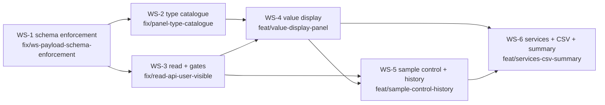

# Plan: System-Audit Follow-up (2026-11) — remediate UF-01…UF-13 and ship the value-management enrichment E1…E10

**Status:** implemented — WS-1…WS-6 landed on `feat/services-csv-summary` (2026-11-08). All task boxes are ticked; the E2E files were extended per plan but must be executed against the shared HA instance (`/home/hermes/ha-test`) before release. Deviations recorded in §9.
**Date:** 2026-11-07
**Written on:** branch `docs/system-audit`
**Source:** `docs/system-audit-2026-11-07.md` — findings UF-01…UF-13, observation O-01, P0/P1 lists, enrichment backlog E1…E10, ha-health-o-mat pattern map (#28–#73)
**Builds on:** `docs/plan-logical-identity-and-panel-ux.md` (§4.1 edit-mode decision, §5.4 wireframes, §3.1 spec registry), `docs/plan-full-abstraction-and-panel-ui.md`, `docs/plan-panel-action-hub.md`, `docs/plan-management-ui-phase1.md`, `docs/plan-naming-identity-templates.md`, `docs/device-mapping-ui-design.md`, `docs/migration-m1-batteries.md`
**Requirements:** `docs/REQUIREMENTS.md` (REQ-CORE-001…009, REQ-COMP-001…005, REQ-SENS-001…004, REQ-DATA-001/002/003, REQ-NFA-001…007, REQ-NAME-001…006) · coverage `docs/REQUIREMENTS_COVERAGE.md` (FA-*/NFA-* scheme)
**Supersedes:** `docs/system-audit-2026-09-06.md`, `docs/system-review-2026-10.md` (kept as history)

---

## 1. Mapping register — every audit item lands in exactly one workstream

| Item | Short | WS |
|---|---|---|
| UF-03 WS payloads bypass the config-flow schemas | **WS-1** |
| UF-01 device-type drift (JS hardcodes 6 of the registry types) | **WS-2** |
| UF-02 `riemann_energy` implicitly enabled against the module contract | **WS-2** |
| UF-08 `entity_name` override unreachable in panel edit/rename forms | **WS-2** |
| UF-04 read/subscribe API admin-gated → non-admins see an empty panel | **WS-3** |
| UF-05 `abstractor/yaml_scan` is a permanently empty placeholder (Migrate tab dead) | **WS-3** |
| UF-09 Import file-input rendered in read-only mode (client-side gap) | **WS-3** |
| UF-13 no non-admin E2E proof of the admin gate | **WS-3** |
| E9 Options visible read-only in the Settings tab | **WS-3** |
| UF-07 no unit / precision / updated_at / delta; `meta` counters travel but never render | **WS-4** |
| UF-06 detail drawer renders raw keys + `JSON.stringify` | **WS-4** |
| UF-10 full-shadow-DOM re-render per update (flicker, O(n·m)) | **WS-4** |
| UF-11 `SubentryMeta.stale` defined, transmitted, never set | **WS-4** |
| UF-12 German i18n strips umlauts | **WS-4** |
| E1 unit & display options per subentry | **WS-4** |
| E6 pipeline visualization in the drawer (replaces UF-06) | **WS-4** |
| E7 sparkline + delta + relative updated_at in value cards | **WS-4** |
| E10 value-management read view on one screen (composes E6+E7) | **WS-4** |
| E2 manual sample control (rejection ids, `abstractor/history`, void/restore) | **WS-5** |
| E3 warning thresholds → derived `ok/warn/bad` health (+ optional warn entity) | **WS-5** |
| E4 structured service responses (`SupportsResponse.OPTIONAL`, flat contract) | **WS-6** |
| E5 CSV round-trip of abstracted values | **WS-6** |
| E8 `summary` report service (aggregates + counters) | **WS-6** |
| O-01 working-tree hygiene (CHANGELOG/manifest 1.4.0 dirty, stray `.write-probe`, submodule pointer) | **WS-6** (hygiene task, never bundled into a feature commit) |

---

## 2. Global constraints inherited by every task

1. **One source of truth.** Panel and WS call the *same* helpers the config flow owns (`_build_new_subentry_data`, `_normalize_subentry_data`, `_schema_for`); nothing reimplements validation or the identity rule.
2. **JS authoring boundary:** the only editable JS is `frontend/src/sensor-form.js` + `frontend/src/abstractor-panel.js`. `custom_components/abstractor/www/abstractor-panel.js` is an esbuild artifact (`scripts/build-frontend.mjs`, `npm run build:frontend`) — audit line numbers point at that bundle; never hand-edit it.
3. **Vanilla, dependency-free, ES2020, no runtime build step** — the existing panel contract; no new npm deps, no framework.
4. **Identity stays pinned:** `CONF_LEGACY_UNIQUE_ID` (`const.py:24`) is write-once-at-creation; no re-derivation from source entity ids, no `unique_id` churn (REQ-CORE-001 / REQ-NAME-001 / GH#19 regression). Shared HA-instance registry accumulates — `unique_id`s never change.
5. **Admin gates writes, not reads** — with redaction on read paths (WS-3). Destructive actions keep a second inline confirmation in the panel; the server gate stays authoritative (client-side edit toggle is cosmetic).
6. **Logging:** `_LOGGER.<level>("… %s", value)` — %s style, never f-strings inside `_LOGGER` calls. **f-strings everywhere else**, never `%` or `str.format`.
7. **Python style:** type hints everywhere (PEP 604 `X | None`), Google-style docstrings on every public class/method, no `from x import *`, Ruff-formatted, values validated before exposure (NaN/None/unavailable).
8. **Config flow keeps 100 % coverage** (project convention): every new/changed flow field needs a `tests/test_config_flow.py` case; new subentry keys need create **and** reconfigure coverage.
9. **Snapshot compatibility:** new persisted keys are additive, `snapshot.py` `validate_snapshot` stays tolerant, `version: 1` unchanged, no `CONFIG_ENTRY_VERSION` bump without an `async_migrate_entry` step (`__init__.py:557`).
10. **Shared HA test instance etiquette** (`/home/hermes/ha-test`, SSOT `/home/hermes/ha-test/README.md`): `bin/sync` only this domain, never `bin/reset` without consensus, never mutate `unique_id`s, language switches only coordinated, never copy/commit `.ha-state/` tokens.

---

## 3. Workstreams

### WS-1 — Schema enforcement: one voluptuous source of truth for flow + WS writes (closes UF-03)

**Depends on:** — · **Branch:** `fix/ws-payload-schema-enforcement` · **Final commit:** `fix: validate websocket payloads with the config flow schemas`

- [x] **1.1 (M)** Extract `SubentryFlowHandler._schema_for` (`custom_components/abstractor/config_flow.py:1140-1230`) into a reusable, HA-free builder `abstract_subentry_schema(device_type)` in a new module `custom_components/abstractor/schema.py`; `config_flow.py` re-exports it so all call sites (`config_flow.py:630`, `:641`, `:690`, `:725`) keep working unchanged. Constraint: numeric-only fields stay hidden for pass-through specs; `legacy_unique_id` stays droppable once pinned. Tests: new `tests/test_schema.py` (table over every enabled spec) + `tests/test_config_flow.py` stays 100 %.
- [x] **1.2 (M)** `custom_components/abstractor/websocket.py:ws_subentry_create` (`:183`) / `ws_subentry_update` (`:234`): validate the submitted `data` with the shared schema **before** any `async_add_subentry`/`async_update_subentry`; `vol.Extra.INVALID` so unknown keys are rejected; `_normalize_subentry_data` remains the single writer. Rejects: `aggregation: "banana"`, non-slug `object_id`, wrong-typed `invert`. Tests: `tests/test_websocket.py` parametrized over an accept/reject payload table.
- [x] **1.3 (S)** Extract the OptionsFlow init schema (`config_flow.py:362-564` → `options_schema()` in `schema.py`) and validate `ws_options_update` (`websocket.py:297-310`): bounded `CONF_POLL_INTERVAL`, Influx host/token/org/bucket keep their selector types (token stays a *selector*, never a raw string), merge into existing `entry.options` instead of replacing the dict. Tests: `tests/test_websocket.py::test_ws_options_update_*` — `poll_interval: "999999"` rejected, unknown key rejected, partial update keeps untouched options.
- [x] **1.4 (S)** Export `WS_COMMAND_TABLE: dict[str, CommandKind]` in `websocket.py` (read / subscribe / write / scan) plus an error-code vocabulary (`schema_violation`, `unknown_field`, `out_of_range`, `not_allowed`, `not_found`); panel renders the code, `_LOGGER.error` logs it (%s style). Tests: `tests/test_websocket.py` asserts the table matches `async_register_websocket`'s registrations exactly (no drift).
- [x] **1.5 (S)** E2E guard: extend `tests_e2e/test_sidebar_panel_form_e2e.py` with one **rejected** payload (bad aggregation) asserting the panel surfaces the server error and the subentry data is unchanged.

### WS-2 — Type catalogue: single-source the spec registry into the panel + naming affordance (closes UF-01, UF-02, UF-08)

**Depends on:** WS-1 (panel-created payloads must satisfy the same schema) · **Branch:** `fix/panel-type-catalogue` · **Final commit:** `feat: drive the panel type catalogue from the spec registry`

- [x] **2.1 (S)** UF-02 `riemann_energy` (`specs.py:87`): apply the user's answer (§6 D-1) — either explicit `enabled=False` or full enablement of the already-implemented integral (`tests/test_riemann.py`, `integration="riemann_left"`). Either way the flag becomes **explicit in code**, `docs/SENSOR_TYPES.md` gains the row, and the decision is recorded as an ADR (MADR standard). Test: `tests/test_specs.py::test_enabled_set_matches_shipped_types` (registry `enabled()` is the single denominator).
- [x] **2.2 (L)** UF-01 — delete the JS hardcode (`frontend/src/sensor-form.js:3-5` `DEVICE_TYPES`/`NUMERIC_TYPES`/`AGGREGATION_MODES`): Python emits `window.AbstractorTypes = {device_types, numeric_types, aggregation_modes, display_names}` at panel registration (`custom_components/abstractor/frontend.py`), mirroring the existing `window.AbstractorI18n` bridge; filter chips (bundle `panel.js:611`), `validateSensorForm`, `buildPayload` and the create-form select consume it with a built-in fallback for the pure-JS harness. Tests: `tests/test_frontend.py` asserts the emitted catalogue equals `SPEC_REGISTRY.enabled()` key-for-key; new `tests/frontend/type-catalogue.test.mjs` (fallback + chip generation); `tests/frontend/sensor-form.test.mjs` updated.
- [x] **2.3 (S)** Python side of the same source: `websocket.py:201` type whitelist and `__init__.py:56 PLATFORMS` derive from `SPEC_REGISTRY` (REQ-SENS-004) so the WS cannot accept a type the panel cannot offer, and vice versa. Tests: `tests/test_specs.py`, `tests/test_websocket.py::test_rejected_types_match_registry`.
- [x] **2.4 (M)** UF-08 `entity_name` affordance: add `entity_name` to `validateSensorForm`/`buildPayload` (`frontend/src/sensor-form.js`) and to the rename-drawer field set (`frontend/src/abstractor-panel.js`, bundle `panel.js:879-994` / `:1024-1119`); `ws_logical_rename` (`websocket.py:313-385`) takes `vol.Optional(CONF_ENTITY_NAME)` and applies it through `_normalize_subentry_data` (already honors it via `naming.py:117` `resolve_entity_name`). `logical_name` stays mandatory only for group renames. Tests: `tests/frontend/sensor-form.test.mjs`, `tests/test_websocket.py` (group vs single-sensor semantics), `tests/test_naming.py` unchanged expectations.
- [x] **2.5 (S)** E2E drift proof: `tests_e2e/test_sidebar_panel_smoke_e2e.py` gains create+filter round-trips for one `binary_sensor`, one `switch`, one `cover` type (previously rejected client-side).

### WS-3 — Read surface, redaction and admin gates (closes UF-04, UF-05, UF-09, UF-13; ships E9)

**Depends on:** WS-1 (command table + error codes) · **Branch:** `fix/read-api-user-visible` · **Final commit:** `fix: make abstractor read paths user-visible with redacted payloads`

- [x] **3.1 (M)** UF-04: drop `_require_admin` from `ws_get_subentries` (`websocket.py:146-152`) and `ws_subentries_subscribe` (`:154-181`); introduce one `redact(payload, is_admin)` writer for both — non-admins lose `legacy_unique_id`, `device_group_id` and the raw `meta.source_states` keys (§6 D-5 pins the list); admins keep the unredacted view. Every write command keeps its `_require_admin`. Tests: `tests/test_websocket.py::test_read_paths_user_visible` + `test_redaction_strips_internal_keys` (table-driven over `WS_COMMAND_TABLE`).
- [x] **3.2 (M)** UF-05: implement a **real, read-only** `ws_yaml_scan` (`websocket.py:387-391`) — extract a side-effect-free `scan_template_sensors(config_dir) -> list[ScanRow]` helper out of `scripts/migrate_local_yaml.py`, rows follow `docs/migration-m1-batteries.md`: `{unique_id, suggested_logical_name, suggested_object_id, source_entities, history_preservable, blockers[]}` + `{scanned_paths, scanned_at}`. Scanning never mutates; the takeover stays in the documented offline script. Tests: new `tests/test_yaml_scan.py` (pure scan over fixture YAML) + `tests/test_websocket.py::test_ws_yaml_scan_shape`.
- [x] **3.3 (S)** Migrate tab (`frontend/src/abstractor-panel.js`): render scan rows + `history_preservable` chip + link to the parity checklist, and distinguish "clean" from "not scannable" (status field). Test: `tests_e2e/test_sidebar_panel_e2e.py` (0 rows and ≥1 fixture row).
- [x] **3.4 (S)** UF-09: header affordances (bundle `panel.js:486-490`) render only when `store.admin && store.editMode`; read-only mode shows a hint to the native UI. Server gate stays authoritative. Test: new `tests/frontend/header-actions.test.mjs` (pure predicate) + `tests_e2e/test_sidebar_panel_smoke_e2e.py` read-only variant.
- [x] **3.5 (M)** UF-13 (port of ha-health-o-mat #28): new `tests_e2e/test_admin_gate_nonadmin_e2e.py` — extend `scripts/e2e_bootstrap.py` with a second non-admin user, open a WS session per user, assert **every** command in `WS_COMMAND_TABLE`: reads succeed (redacted), writes answer `not_allowed`; plus a coverage assertion that the table covers all registered commands. Shared-instance etiquette per §2.10.
- [x] **3.6 (M)** E9: new redacted read command `abstractor/options/read` → `{poll_interval, influx_enabled, naming_template_names, debug_gate_set, notify_set}` (Influx token/org/host never returned — set/unset booleans only) + Settings-tab renderer with deep links into the Options Flow. Tests: `tests/test_websocket.py::test_options_read_never_leaks_secrets`, `tests_e2e/test_sidebar_panel_e2e.py::test_settings_tab_renders_options`.

### WS-4 — Value display & read view (closes UF-06, UF-07, UF-10, UF-11, UF-12; ships E1, E6, E7, E10)

**Depends on:** WS-1 (schema/payload plumbing), WS-2 (type catalogue for chips/labels), WS-3 (redacted payload shape the renderer consumes) · **Branch:** `feat/value-display-panel` · **Final commit:** `feat: render units, delta, sparklines and pipeline stages in the panel`

- [x] **4.1 (M)** UF-11 backend: `custom_components/abstractor/coordinator.py` — set `SubentryMeta.stale` from poll age (`now - last_poll > 2 * update_interval`) instead of the literal `False` (`coordinator.py:39`, `:184`, `:223`); add `updated_at: datetime | None` per subentry to `SubentryMeta` and to `_meta_payload` (`websocket.py:79-96`, ISO-8601). Type hints + Google docstring on the dataclass fields. Tests: `tests/test_coordinator.py::test_stale_flips_after_two_intervals`, `tests/test_websocket.py::test_meta_payload_keys`.
- [x] **4.2 (M)** E1/UF-07 data layer: new keys `CONF_DISPLAY_UNIT` / `CONF_DISPLAY_PRECISION` (`const.py` block at `:43-50`) added to the shared schema (WS-1 1.1) **and** to `custom_components/abstractor/strings.json` + `translations/de.json` (create **and** reconfigure sections); unit-mismatch detection against `spec.unit` with a tolerant equivalence table (`kWh/kwh/KWH`, `m³/m3`, `µmol/L ≡ umol/L` — ha-health-o-mat #73) that raises a flow error, never coerces silently. Conversion applies **at the render boundary only**; persisted value and Influx payload keep the spec unit (§6 D-4). Add the unit/state_class change note to `docs/RELEASE_PROCESS.md` (ha-health-o-mat #29). Tests: `tests/test_config_flow.py` (100 % for both keys, create + reconfigure), `tests/test_specs.py::test_unit_equivalence_table`, `tests/test_influx_exporter.py` unchanged (spec-unit push).
- [x] **4.3 (L)** E7/UF-07/E10 render layer: pure formatters in `frontend/src/sensor-form.js` — `formatValue(value, unit, precision)`, `deltaWithSign(current, previous)`, `relativeTime(updatedAt)`, `sparklinePath(samples, width, height)` (60-sample ring; non-numeric states render as a state strip, not a line). Devices-tab rows become the value-management read view: friendly name · value+unit · Δ · updated_at · health chip · sparkline. Ring buffer lives in the panel store, fed from the **existing** subscribe stream — no extra WS traffic, no second polling loop (REQ-NFA-001). Tests: new `tests/frontend/value-format.test.mjs` (NaN/None/unavailable, first-sample delta is null), `tests_e2e/test_sidebar_panel_smoke_e2e.py` asserts a unit suffix and a relative timestamp render.
- [x] **4.4 (L)** E6/UF-06 drawer: structured stage list `sources → aggregation → spike → invert → net-subtract → fallback → display`, active stages highlighted, `meta.last_event` + `event_at` annotated, identity block renders the **pinned** `legacy_unique_id` read-only, all labels from a label map — no raw subentry keys, no `JSON.stringify` (bundle `panel.js:555-565`). Field labels reuse the `strings.json` vocabulary; panel text keeps its own i18n dict. Tests: new `tests/frontend/pipeline-drawer.test.mjs` (pure selector over fixture subentries: pass-through hides numeric stages, multi-source marks aggregation active), `tests_e2e/test_sidebar_panel_form_e2e.py` drawer content replaces the raw-key expectation.
- [x] **4.5 (M)** UF-10 memoized render: extract the store into a pure module `frontend/src/store.js` with a `revision` counter; re-render only on revision change and patch cards incrementally instead of `innerHTML` + full listener re-attach (bundle `panel.js:497`, `:508-527`). Expose `renderCount` for assertions. Tests: new `tests/frontend/store.test.mjs` (revision bumps, subscriber counts, unchanged payload → no render) + smoke E2E stays green.
- [x] **4.6 (S)** UF-12 i18n: correct umlauts in `I18N.de` (`frontend/src/abstractor-panel.js`, bundle `:187-256`) using the same vocabulary as `translations/de.json`; add the new keys (`value.unit`, `updated_at`, `delta`, `rejected_samples`, `sparkline`, `stage.*`, `health.*`) to **both** dictionaries, keep `_langFor` → `en` fallback. Tests: new `tests/frontend/i18n.test.mjs` (every key present in `de` and `en`, no umlaut-stripped strings); `tests_e2e/test_translations_e2e.py` extended to panel labels — only in a coordinated language run (§2.10 rule 4).

### WS-5 — Sample control & value history (ships E2, E3)

**Depends on:** WS-1 (validation helper + error codes), WS-3 (read/write classification), WS-4 (`meta` already rendered) · **Branch:** `feat/sample-control-history` · **Final commit:** `feat: add value history pagination with void/restore and warn thresholds`

- [x] **5.1 (M)** E2 backend: `coordinator.py` records rejected samples — bounded `deque(maxlen=200)` per subentry in `SubentryMeta` (`rejected: list[Sample]`, `Sample = {id, at, raw, reason}`), stable ids `f"{subentry_id}_{poll_iso}_{seq}"`; `filters.py` `AbstractorFilterPipeline` surfaces the rejected raw value + reason (extend its result, keep `last_event` strings backward compatible). Bounded memory, no extra polling (REQ-NFA-001 / REQ-COMP-002). Tests: `tests/test_filters.py` (reason+raw on spike/fallback), `tests/test_coordinator.py::test_rejected_ring_bounded_and_id_stable`.
- [x] **5.2 (M)** `abstractor/history` read command in `websocket.py` (ha-health-o-mat #70 contract): request `{subentry_id, limit (cap 200), offset, has_more}` — a cap that would truncate is **rejected loud**, never silently applied; response `{samples[], total, has_more}`; classified `read` in `WS_COMMAND_TABLE` so 3.1's redaction applies. Tests: `tests/test_websocket.py::test_history_pagination` (offset past end, `has_more` semantics, oversized limit rejected), `tests/test_coordinator.py::test_history_order_is_stable`.
- [x] **5.3 (M)** `abstractor/void_sample` + `abstractor/restore_sample` (write-classified, admin-gated, addressed by sample id): mutate only the coordinator ring + a persisted void list under `STORAGE_KEY` (`snapshot.py` version stays 1); **never** touch `legacy_unique_id`, the entity-registry row or recorder history — state that boundary in the docstring (REQ-CORE-001/REQ-CORE-003). Restore is idempotent (`{restored: 0}` for an active sample). Tests: `tests/test_websocket.py::test_void_restore_pair` (double void, unknown id → `invalid`, `unique_id`/`entity_id` unchanged), `tests/test_snapshot.py::test_void_list_is_additive`.
- [x] **5.4 (M)** E3 thresholds: `CONF_WARN_ABOVE` / `CONF_WARN_BELOW` (+ optional `CONF_WARN_CONDITION_ENTITY_ID`) in the shared schema and in the flow (`strings.json`/`translations/de.json`), `meta.health: ok|warn|bad` computed in the coordinator (numeric compare; condition gate reuses the `_fallback_condition_met` pattern from `coordinator.py:238-252`); payload `health` (`websocket.py:116-124`) becomes threshold-derived and falls back to the event heuristic when no thresholds are set. Tests: `tests/test_coordinator.py::test_meta_health_thresholds` (above/below/gated/none), `tests/test_config_flow.py` (100 % for both keys), `tests/test_websocket.py::test_health_key_threshold_driven`.
- [x] **5.5 (S)** Panel Health tab: per-sensor "rejected samples" list (id, time, raw, reason) + void/restore buttons (edit mode + admin only, second confirmation on void), threshold chips, deep link into the reconfigure flow; never renders values the redaction removed. Tests: `tests/frontend/sample-list.test.mjs` (pure list builder), `tests_e2e/test_sidebar_panel_e2e.py::test_health_tab_lists_rejections`.
- [x] **5.6 (S)** Optional warn companion entity (§6 D-2): if "yes", a per-subentry warn `binary_sensor` fed by `meta.health`, registered on the **same** subentry device via `DeviceInfo` (REQ-CORE-006), named through `naming.py`, never on the pinned identity path; if "no", note it in `docs/SENSOR_TYPES.md`. Test (only if yes): `tests/test_binary_sensor.py::test_warn_companion_shares_device`.

### WS-6 — Services, CSV round-trip, structured responses, summary + hygiene (ships E4, E5, E8; lands O-01)

**Depends on:** WS-1 (schemas/error codes), WS-3 (gate + edit-mode affordance rules), WS-4 (render targets for response summaries), WS-5 (sample rings feed `summary`) · **Branch:** `feat/services-csv-summary` · **Final commit:** `feat: add csv round-trip, structured service responses and a summary service`

- [x] **6.1 (S)** E4: re-register `import_data_service` (`__init__.py:646`) and `delete_sensor_service` (`__init__.py:769`) with `supports_response=SupportsResponse.OPTIONAL` and a flat contract — import `{recreated[], kept[], skipped[], errors[]}`, delete `{entity_id, device_id, history_preserved}`; `errors` ≤ 20 texts and **no raw sensor values** in any error text (ha-health-o-mat #71 privacy rule). Tests: `tests/test_services.py::test_import_response_contract` + `test_delete_response_contract` (shape, cap, privacy regex), `tests/test_snapshot.py` untouched.
- [x] **6.2 (M)** E5: new HA-free module `custom_components/abstractor/csv_values.py` + services `export_csv` / `import_csv` registered next to `__init__.py:485-503` (and unregistered at `:550-552`): exactly-one-source rule `filename` **xor** `content` via `vol.Exclusive`, UTF-8 cap 2 MiB (fail loud, no truncation), `;` separator, header `logical_name;entity_id;device_type;value;unit;updated_at`, admin-only, export dir importable through the HA `selector` API, values read only from `coordinator.data` + `meta` (no second source of truth). Tests: `tests/test_services.py::test_csv_xor_rejected`, `test_csv_size_cap_fails_loud`, `test_csv_roundtrip_is_lossless_for_numeric_sensors`, new `tests/test_csv_values.py` (pure serializer/parser; decimal-separator decision documented in the module docstring).
- [x] **6.3 (M)** E8: `summary` service, `SupportsResponse.ONLY`, contract `{generated_at, window_days, sensors[{logical_name, entity_id, device_type, value, unit, updated_at, min, max, avg, spike_rejections, fallbacks, health}]}`; sources are the coordinator ring + `meta` counters + `hass.states` availability — **not** private recorder internals; document the per-field source so dashboards can rely on it (ha-health-o-mat `weekly_report` foundation). Tests: `tests/test_services.py::test_summary_contract_stable`, new `tests/test_summary.py` (pure aggregation: empty window, single sample, bounded window).
- [x] **6.4 (M)** Panel wiring (`frontend/src/abstractor-panel.js`): Import shows the response summary instead of silence; Settings tab gains Export / CSV / Summary buttons (edit-mode gated per 3.4); delete confirmation surfaces `history_preserved`. Pure formatters (`summaryCard()`, `importSummary()`) live in `frontend/src/sensor-form.js`. Tests: new `tests/frontend/service-summary.test.mjs`, `tests_e2e/test_sidebar_panel_smoke_e2e.py::test_import_reports_recreated_count` (same websocket-frame assertion pattern as the existing export test).
- [x] **6.5 (S)** O-01 hygiene + docs: remove the stray `.write-probe`, confirm `__pycache__` stays gitignored, land `CHANGELOG.md` + `manifest.json` 1.4.0 in a **release** commit (never bundled with a feature commit), coordinate the `external/ReqogniLoom` submodule pointer through the `git` role (submodule-protection rule). Docs pass: `docs/REQUIREMENTS_COVERAGE.md` (FA-02/FA-12 re-verified against WS-3/WS-5), `README.md` config reference rebuilt from `schema.py` (every field added by WS-2/4/5/6 is missing today), `docs/AUDIT_UI_CONFIG.md` resolution note. Check: `python3 -m script.hassfest --integration-path custom_components/abstractor` green.

---

## 4. Execution order & dependency graph



| Order | WS | Why it precedes the next |
|---|---|---|
| 1 | WS-1 | Every payload path (panel → WS → flow) is only as strict as the schema it shares; fixing it first prevents WS-2/4/5/6 from re-baking drift, and it creates the error-code vocabulary the panel needs |
| 2 | WS-2 | The catalogue decides *what a subentry may be*; WS-4's chips/labels and WS-5's per-type thresholds would be rewritten against a stale 6-type list otherwise |
| 3 | WS-3 | Read paths + redaction fix the payload shape every renderer consumes, and the non-admin E2E (UF-13) protects the gates before WS-4/WS-5 put more value data on screen |
| 4 | WS-4 ∥ WS-5 | May run as parallel branches; WS-5's Health-tab list assumes WS-4's `meta` rendering already exists |
| 5 | WS-6 | Services consume WS-3's gate rules, WS-4's response-summary render target and WS-5's sample rings — last, so the persisted format (void list, CSV) is introduced once |

Sizes: **S** < 1 working day · **M** 1–2 d · **L** 3–5 d (single developer). Overall effort estimate: delegate to `effort-estimator` (text reference only) — 6 workstreams, 33 tasks (3 × L, 17 × M, 13 × S), two workstreams touch shared E2E state and need coordination on the test instance.

---

## 5. Definition of Done — per workstream

Common gate (every WS, before its final commit):

```bash
# secret-scanning block (Security Paved Road) — a finding blocks the commit, report + ask for manual intervention
git diff --cached | rg -n "(api[_-]?key|token|secret|password)\s*[:=]|\.ha-state/|gh[pousr]_" && echo "BLOCKED — do not commit"
git diff --cached | rg -n "is_admin.*True|SECRET_TOKEN\s*=" && echo "BLOCKED — do not commit"

rtk ruff check custom_components/abstractor
rtk ruff format --check custom_components/abstractor
python3 -m script.hassfest --integration-path custom_components/abstractor
pytest tests/ -v --cov=custom_components/abstractor --cov-report=term-missing
pytest tests/test_config_flow.py -vv --cov=custom_components/abstractor.config_flow --cov-report=term-missing   # must show no missing lines
npm run build:frontend && git diff --stat custom_components/abstractor/www/abstractor-panel.js
node --test tests/frontend/*.test.mjs      # equivalently: npm run test:frontend
```

| WS | WS-specific "done" evidence |
|---|---|
| WS-1 | `pytest tests/test_schema.py tests/test_websocket.py -v` green; the reject table (`aggregation: "banana"`, `poll_interval: 999999`, unknown key) all raise WS errors, nothing persisted; `git grep -n "vol.Required(\"data\"): dict" custom_components/abstractor/websocket.py` returns nothing |
| WS-2 | `pytest tests/test_specs.py tests/test_frontend.py -v` green (emitted catalogue == `SPEC_REGISTRY.enabled()`); `node --test tests/frontend/type-catalogue.test.mjs` green; `git grep -nF '"door_contact", "motion", "smoke"' frontend/src custom_components/abstractor/www` empty (the 6-type hardcode is gone; a documented fallback list may remain but must not be the source of truth); one non-`sensor` type created + filtered in `pytest tests_e2e/test_sidebar_panel_smoke_e2e.py -v` |
| WS-3 | `pytest tests/test_websocket.py tests/test_yaml_scan.py -v` green incl. redaction; `pytest tests_e2e/test_admin_gate_nonadmin_e2e.py -v` green (non-admin: reads ok, writes `not_allowed` for every table row); no `Connection refused`, panel non-empty for the non-admin user in the smoke test |
| WS-4 | `node --test tests/frontend/*.test.mjs` green (value-format, drawer, store, i18n); `pytest tests/test_coordinator.py tests/test_config_flow.py -v --cov=custom_components/abstractor.config_flow` shows 0 missing config-flow lines; `git grep -n "JSON.stringify" frontend/src/abstractor-panel.js` empty; `renderCount` assertion proves memoization |
| WS-5 | `pytest tests/test_filters.py tests/test_coordinator.py tests/test_websocket.py -v` green; void/restore pair test proves `unique_id`/`entity_id` unchanged and `snapshot.py` version still 1; `pytest tests_e2e/test_sidebar_panel_e2e.py -v` shows the rejection list |
| WS-6 | `pytest tests/test_services.py tests/test_csv_values.py tests/test_summary.py -v` green (xor rejection + 2 MiB cap + response contracts); `pytest tests_e2e/test_sidebar_panel_smoke_e2e.py -v` proves Import reports `recreated`; hassfest green; CHANGELOG/manifest landed in the release commit only |

CI gate (all WS, after push — the `git` role owns push/tagging):

```bash
gh run list --workflow validate.yaml --limit 5     # .github/workflows/validate.yaml (HACS Action + Hassfest + ruff)
gh run list --workflow e2e.yaml --limit 5          # .github/workflows/e2e.yaml (pytest tests_e2e/ on the e2e container)
gh pr checks "$PR_BRANCH"                          # both workflows must be pass
```

Local E2E against the shared instance (coordinated, see §2.10): `bin/sync <repo-dir>` → `pytest tests_e2e/ -v` (SSOT: `/home/hermes/ha-test/README.md`).

---

## 6. Open decisions — need the user's answer before the affected task starts

| # | Decision | Affects | Options · recommendation |
|---|---|---|---|
| **D-1** | `riemann_energy`: enable fully (needs the `riemann_left` integration dependency, already implemented in `tests/test_riemann.py`) **or** disable with an explicit `enabled=False`? UF-02: the module comment claims "not enabled", the code ships it enabled | WS-2 · 2.1 | Recommendation: **disable** until REQ-SENS-003 is re-reviewed against HA Core's own Riemann integration — the panel cannot model it today (UF-01 makes that moot once WS-2 lands, but the dependency on an external integration is a policy question) |
| **D-2** | Warn companion entity: per-subentry warn `binary_sensor` from `meta.health` — yes or no? | WS-5 · 5.6 | Recommendation: **no** in this pass — the health chip + Health tab already cover it; adding an entity per sensor changes entity-registry counts and surprises dashboards. Yes only if users want automations to consume it |
| **D-3** | CSV service naming/domain: `abstractor.export_csv` + `abstractor.import_csv` vs. extending the existing `export_data`/`import_data` with a `format` parameter | WS-6 · 6.2 | Recommendation: **separate `export_csv`/`import_csv`** — the JSON snapshot contract (`version: 1`) stays untouched and REQ-DATA-001/003 semantics stay testable |
| **D-4** | Does `display_unit` conversion also apply at the **Influx push** boundary, or panel-only? | WS-4 · 4.2 | Recommendation: **panel-only** — Influx buckets are external consumers; converting them is a breaking change for existing graphs (needs the ha-health-o-mat #29 migration note if changed) |
| **D-5** | Exact non-admin redaction key list | WS-3 · 3.1 | Recommendation: drop `legacy_unique_id` + `device_group_id` only; keep `unique_id` (already visible in the entity-registry UI) and keep `meta.source_states` (needed to explain a value); revisit if `device_group_id` proves necessary for grouping the read-only card view — then expose a hashed group id instead |
| **D-6** | UF-05: implement the real scan (planned here) **or** delete the Migrate tab? | WS-3 · 3.2/3.3 | Recommendation: **implement the scan read-only**; the `.storage` transplant stays out of scope (already documented in `docs/migration-m1-batteries.md` + `scripts/migrate_local_yaml.py`) |
| **D-7** | Sparkline source: JS-side 60-sample ring (panel only, resets on reload) vs. a persisted backend ring read via `abstractor/history` | WS-4 · 4.3 vs WS-5 · 5.2 | Recommendation: **JS ring for display** (cheap, no persisted format change) and the WS history command for export/void workflows; revisit a persisted ring only if users want sparklines that survive an HA restart |
| **D-8** | `updated_at` semantics: coordinator poll time (planned) vs. source entity `last_updated` propagation | WS-4 · 4.1 | Recommendation: **poll time** — it is what the panel can prove, and a source `last_updated` would imply the value changed |
| **D-9** | Should the read paths expose history/values to non-admins at all (D-5 interplay)? | WS-3 · 3.1 + WS-5 · 5.2 | Recommendation: **yes** — HA values are already public to any paired user; only internal ids are redacted |
| **D-10** | Void/restore persistence: HA `Store` (`STORAGE_KEY`, additive key) vs. in-memory only | WS-5 · 5.3 | Recommendation: **Store-persisted**, so voided samples stay voided across reloads (every subentry edit reloads the entry) |

### 6.1 Decision log (2026-11-07 — defaults applied, owner may override any time)

| # | Applied decision | Rationale |
|---|---|---|
| D-1 | `riemann_energy`: explicit `enabled=False` | external-integration dependency stays a policy question until REQ-SENS-003 is re-reviewed |
| D-2 | warn companion `binary_sensor`: **no** | health chip + Health tab cover it; no surprise entity-registry additions |
| D-3 | separate `export_csv`/`import_csv` services | JSON snapshot contract (`version: 1`) untouched |
| D-4 | `display_unit` conversion: **panel-only** | Influx buckets are external consumers; spec unit persisted + pushed |
| D-5 | redaction drops `legacy_unique_id` + `device_group_id` only | `unique_id` visible in registry UI; `source_states` needed to explain a value |
| D-6 | real read-only `yaml_scan` implemented | takeover transplant stays out of scope (documented in M1 doc) |
| D-7 | sparkline: JS-side ring for display | WS history command serves export/void workflows; persisted ring only on demand |
| D-8 | `updated_at` = coordinator poll time | provable by the panel; source `last_updated` would imply change |
| D-9 | history/values exposed to non-admins: **yes** (redacted) | HA values already public to any paired user |
| D-10 | void/restore persisted in HA `Store` (`STORAGE_KEY`, additive) | voided samples stay voided across reloads |

## 7. Out of scope (deliberate non-goals for this plan)

- Actuators/climate domain expansion and the YAML→`.storage` takeover transplant — owned by `docs/plan-logical-identity-and-panel-ux.md` (WS-C/WS-G), not re-planned here.
- Event-driven refresh (latency, that plan's WS-E), HACS/brand asset work, and any `manifest.json` floor change.
- Snapshot `version` bump or `CONFIG_ENTRY_VERSION` bump — everything added here must stay additive.

## 8. References

- `docs/system-audit-2026-11-07.md` (source of every UF/E/O id used above)
- `docs/plan-logical-identity-and-panel-ux.md` §3.1 (spec registry), §5.3 (edit-mode gate), §5.4 (wireframes), WS-C/WS-E/WS-G (out of scope)
- `docs/plan-full-abstraction-and-panel-ui.md` §4.1 (edit-mode decision), `docs/plan-panel-action-hub.md`, `docs/plan-management-ui-phase1.md`
- `docs/device-mapping-ui-design.md` (registry transaction the WS reuses), `docs/migration-m1-batteries.md` (M1 scan schema)
- ha-health-o-mat issues #28, #29, #30, #31, #32, #70, #71, #72, #73 as the pattern map in §4 of the audit
- Shared test instance SSOT: `/home/hermes/ha-test/README.md`
- CI: `.github/workflows/validate.yaml`, `.github/workflows/e2e.yaml`

## 9. Implementation notes (2026-11-08)

- **WS-4.3/4.4/4.6 structure**: the pure formatters live in
  `frontend/src/sensor-form.js`, the dictionary in `frontend/src/i18n.js`, and
  the pipeline selector in `frontend/src/pipeline.js` (instead of one large
  panel module). Tests: `value-format`, `pipeline-drawer`, `i18n`.
- **WS-4.5**: the store moved to `frontend/src/store.js` with a deep-equality
  revision guard; device cards are reused per subentry signature instead of
  rebuilding the whole list (test: `store.test.mjs`, `renderCount` on the
  element).
- **WS-3.6**: `abstractor/options/read` is a flat, credential-free contract for
  **every** role (not just non-admins); Influx host/org/bucket never leave the
  backend. The Settings tab labels the resolved fields.
- **WS-6.4**: delete now goes through the admin-gated WS command, whose response
  mirrors the service contract (`entity_id`, `device_id`, `history_preserved`).
  JSON/CSV/summary actions live in the Settings tab and render their responses.
- **WS-2.5**: E2E coverage is in `tests_e2e/test_type_catalogue_e2e.py`
  (form options + create/filter round-trip); it requires the shared HA
  instance and was not executed as part of the local unit run.
- **O-01**: ruff check is green for `custom_components/abstractor`; the
  touched Python files are ruff-formatted. A repo-wide `ruff format` remains a
  separate chore (pre-existing 21-file debt). The `external/ReqogniLoom`
  pointer is intentionally not part of the feature/release commits.

